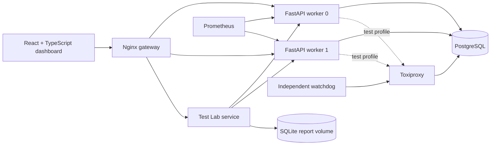

# Distributed Spatial ID System

A full-stack reference system for generating globally unique, approximately
time-sortable 128-bit identifiers for spatial vehicle events.

The project combines a dependency-free Python ID library, a durable FastAPI
service, PostgreSQL and SQLite storage modes, a React operations dashboard,
Prometheus metrics, and a controlled failure-testing lab. It is designed as a
systems-engineering portfolio project: the interesting parts are atomicity,
idempotency, clock safety, worker fencing, recovery, and observable failure—not
just packing fields into an integer.

> Spatial data embedded in an ID is deliberately approximate. This system is
> not navigation, collision-avoidance, flight-control, or safety-critical software.

## Contents

- [What the system does](#what-the-system-does)
- [Architecture](#architecture)
- [ID format](#id-format)
- [Quick start](#quick-start)
- [Using the dashboard](#using-the-dashboard)
- [Python library and CLI](#python-library-and-cli)
- [HTTP API example](#http-api-example)
- [Reliability model](#reliability-model)
- [Testing and measured results](#testing-and-measured-results)
- [Repository layout](#repository-layout)
- [Documentation](#documentation)
- [Scope and limitations](#scope-and-limitations)

## What the system does

- Generates canonical lowercase, zero-padded, 32-character hexadecimal IDs.
- Places generation time in the most significant bits for millisecond ordering.
- Quantizes latitude, longitude, altitude, speed, and vehicle class into the ID.
- Decodes IDs without requiring a database lookup.
- Persists original event inputs and vehicle history after a durable commit.
- Supports atomic batches of up to 1,000 IDs.
- Makes retries repeatable across processes and restarts using idempotency keys.
- Prevents stale workers from allocating IDs using leases and fencing tokens.
- Runs with shared PostgreSQL or as a single-node SQLite deployment.
- Exposes health, readiness, process statistics, and Prometheus metrics.
- Simulates bounded database latency and disconnection through Toxiproxy.
- Preserves Test Lab reports outside the PostgreSQL failure domain.

## Architecture



The normal networked stack contains the gateway, two API replicas, a migration
job, and PostgreSQL. The testing overlay routes the API database connections
through Toxiproxy and adds the Test Lab plus its watchdog. The standalone stack
uses one API and SQLite.

See [Architecture and invariants](docs/architecture.md) for the transaction,
lease, timing, and recovery model.

## ID format

| Field | Bits | Range or meaning |
|---|---:|---|
| Timestamp | 41 | Milliseconds since `2026-01-01T00:00:00Z` |
| Version | 4 | V1 is `1` |
| Latitude cell | 19 | 524,288 global cells; north pole maps to final cell |
| Longitude cell | 20 | 1,048,576 global cells |
| Altitude | 12 | One-metre buckets from `-1024` through `<3072 m` |
| Speed | 8 | One-metre/second buckets from `0` through `<256 m/s` |
| Vehicle class | 4 | Integer category `0–15` |
| Worker | 10 | Exclusively owned worker `0–1023` |
| Sequence | 10 | `0–1023` per worker per millisecond |

```text
127                                                           0
+-----------+---+--------+---------+--------+-----+-----+------+--------+
| time 41b  |v4 | lat 19 | lon 20  | alt 12 |spd 8|cls 4|wrk 10|seq 10 |
+-----------+---+--------+---------+--------+-----+-----+------+--------+
```

The timestamp field controls ordering across milliseconds. IDs created in the
same millisecond are unique under the worker-assignment assumptions, but do not
claim exact global creation order. Decoding returns cell buckets, bounds, and
centres; it does not invent the original lossy coordinates.

## Quick start

### Prerequisites

- Docker Desktop with Compose v2
- 4 GB or more free memory recommended for the complete testing stack
- A browser for the dashboard

Start the default networked deployment:

```powershell
docker compose up -d --build --wait
```

Open [http://localhost:8080](http://localhost:8080). Only the Nginx gateway is
published on the host, and it binds to loopback by default. PostgreSQL and API
containers remain internal to the Compose network.

Check status and logs:

```powershell
docker compose ps
docker compose logs --tail 100 api-0 api-1 migrate gateway
```

Stop the application without deleting records:

```powershell
docker compose down
```

Do not add `-v` unless deleting persistent database data is intentional.

### Enable the failure-testing lab

```powershell
$env:TEST_TOKEN = 'choose-a-local-secret'
docker compose -f compose.yaml -f compose.test.yaml up -d --build --wait
```

Enter the token in the Test Lab screen. The browser keeps it in memory only.
The runner accepts fixed internal targets and allowlisted scenarios; callers
cannot provide arbitrary URLs or shell commands. Network faults last no more
than ten seconds, and the independent watchdog restores expired faults.

### Run standalone SQLite mode

```powershell
$env:WEB_PORT = '8080'
docker compose -f compose.local.yaml up -d --build
```

This mode runs a single API process with a persistent SQLite volume. It does not
synchronize with PostgreSQL and intentionally omits the network-failure lab.

Detailed setup instructions, environment variables, and troubleshooting are in
[Getting started](docs/getting-started.md).

## Using the dashboard

| Screen | Purpose |
|---|---|
| Generate | Submit spatial fields and durable batches; copy or export IDs |
| Decode | Inspect every encoded field and approximate spatial cell |
| History | Search by vehicle and capture time, page results, inspect and export |
| Health | Compare API readiness, database state, latency, throughput and errors |
| Test Lab | Run bounded load/fault scenarios, cancel, watch recovery, download reports |

IDs remain strings in the browser to avoid JavaScript's integer precision limit.
If `API_TOKEN` is configured, enter it in the sidebar. The Test Lab uses a
separate `TEST_TOKEN` so operational data access and destructive test controls
can be managed independently.

## Python library and CLI

Python 3.11 or later is required. The core library has no runtime dependencies.

```powershell
python -m venv .venv
.\.venv\Scripts\python -m pip install -e .
```

```python
from spatial_id import SpatialIdGenerator, decode

generator = SpatialIdGenerator(worker_id=21)
value = generator.generate(
    latitude=12.9716,
    longitude=77.5946,
    altitude_m=120.4,
    speed_mps=17.8,
    vehicle_class=3,
)

print(value)                  # 32-character lowercase hexadecimal
print(decode(value).to_dict())
```

The direct generator is thread-safe, but the caller must assign each live
process an exclusive worker ID and prevent unsafe same-millisecond worker reuse
after restart. Use the durable service when restart coordination matters.

CLI examples:

```powershell
spatial-id generate --worker 21 --lat 12.9716 --lon 77.5946 --altitude 120.4 --speed 17.8 --vehicle-class 3 --count 2
spatial-id decode 02e2587b2e0c9396b72da47811305400
spatial-id benchmark --worker 21 --lat 12.9716 --lon 77.5946 --altitude 120 --speed 18 --count 100000 --threads 8
spatial-id serve --worker 21 --state .spatial-id\state.db --port 8080
```

## HTTP API example

```powershell
$headers = @{
  'Content-Type' = 'application/json'
  'Idempotency-Key' = 'vehicle-42-sample-0001'
}
$body = @{
  vehicle_id = 'VEH-42'
  latitude = 12.9716
  longitude = 77.5946
  altitude_m = 120.4
  speed_mps = 17.8
  vehicle_class = 3
  count = 10
} | ConvertTo-Json

Invoke-RestMethod -Method Post -Uri http://localhost:8080/v1/ids -Headers $headers -Body $body
```

The first committed request returns `201`. Repeating the exact payload and key
returns the original result with `200`. Reusing the key with different normalized
inputs returns `409`. A timeout has an uncertain outcome: retry the exact key and
payload before doing anything else.

See the complete [API contract](docs/api.md) for routes, validation rules,
pagination, error codes, authentication, and retry behavior.

## Reliability model

Each durable generation batch runs in one database transaction:

1. Serialize the idempotency key.
2. Return a matching committed response if it already exists.
3. Lock and validate the worker lease and fencing token.
4. Validate clock monotonicity and allocate a sequence range.
5. Insert immutable event records.
6. Store the idempotency response and advance worker state.
7. Revalidate ownership and commit before returning success.

This produces atomic batches: the response, records, request key, and allocation
state commit together, or none do. PostgreSQL uses advisory and row locks;
SQLite uses `BEGIN IMMEDIATE`, WAL mode, and full synchronization.

Uniqueness assumes that one active owner holds each worker ID and that restored
state is never allowed to reuse timestamps emitted after its backup point. The
service enforces leases and fencing at runtime; backup recovery still requires
the operator procedure in [Operations and recovery](docs/operations.md).

## Testing and measured results

The verified development run completed:

- 72 Python unit, integration, crash, storage, and real-service tests on Linux.
- 3 Chromium end-to-end dashboard tests.
- Two-replica idempotency and client-disconnect checks.
- Load, database-latency, database-disconnect, and cancellation scenarios.
- Independent watchdog recovery while the Test Lab runner was paused.
- PostgreSQL binary backup/restore and SQLite restart persistence.
- Zero duplicate IDs in all measured benchmark and failure scenarios.

Observed 1,000-ID smoke-test throughput on Docker Desktop/WSL2, using batch 100:

| Mode | IDs/second | Durability |
|---|---:|---|
| Core library | 66,043 | In-memory only |
| SQLite | 8,653 | WAL + FULL synchronization |
| PostgreSQL | 2,830 | Synchronous commit through local proxy |

These are small development samples, not capacity claims. Hardware, storage,
concurrency, batch size, and network topology materially change results. Exact
conditions and tail-latency caveats are recorded in
[Verification and benchmarks](docs/verification.md).

## Repository layout

```text
spatial_id/             Core library, CLI, FastAPI app, storage and Test Lab
frontend/               React/TypeScript dashboard, Nginx and Playwright tests
tests/                  Unit, integration, crash and live HTTP tests
scripts/                Benchmarks and bounded acceptance/failure workflows
deploy/                 Prometheus and standalone gateway configuration
docs/                   Architecture, API, operations, security and guides
compose.yaml            Two-replica PostgreSQL deployment
compose.local.yaml      Single-node SQLite deployment
compose.test.yaml       Toxiproxy, Test Lab and watchdog overlay
Dockerfile              Python service/test image
pyproject.toml          Package metadata, extras and CLI entry point
```

## Documentation

Start with the [documentation index](docs/README.md).

- [Getting started](docs/getting-started.md)
- [Architecture and guarantees](docs/architecture.md)
- [Data model and lifecycle](docs/data-model.md)
- [API and retry contract](docs/api.md)
- [Development guide](docs/development.md)
- [Testing strategy](docs/testing.md)
- [Operations and recovery](docs/operations.md)
- [Security model](docs/security.md)
- [Design decisions](docs/design-decisions.md)
- [Failure matrix](docs/failure-matrix.md)
- [Verification and benchmarks](docs/verification.md)
- [Interview guide](docs/interview-guide.md)
- [Contributing](CONTRIBUTING.md)
- [Roadmap](ROADMAP.md)

## Scope and limitations

This release intentionally does not include vehicle identity management,
trajectories, previous/next links inside IDs, 3D velocity vectors, direction,
maps, collision detection, navigation logic, public cloud deployment, offline
synchronization, or a network SDK.

PostgreSQL uses a single primary. Automatic failover, replication, multi-region
consensus, worker-ID leasing across independent databases, and disaster recovery
automation are future work. Records and idempotency results are retained without
automatic expiry, so production use requires capacity planning and an archival
policy. Public exposure also requires TLS, a real identity system, authorization,
managed secrets, per-principal rate limits, audit logs, and an external security
review.

## License

Package metadata declares the project under the MIT license. Add a repository
`LICENSE` file with the intended copyright holder before public distribution.
