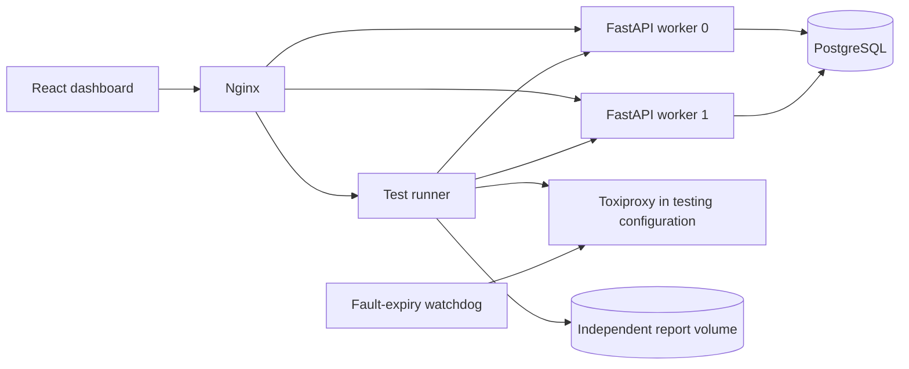

# Architecture

The testing configuration puts Toxiproxy between the APIs and PostgreSQL. SQLite
standalone mode uses one local API and a local filesystem database.

## Bit layout and quantization

| Field | Bits | Least-significant bit shift |
|---|---:|---:|
| Timestamp | 41 | 87 |
| Version (1) | 4 | 83 |
| Latitude | 19 | 64 |
| Longitude | 20 | 44 |
| Altitude | 12 | 32 |
| Speed | 8 | 24 |
| Vehicle class | 4 | 20 |
| Worker | 10 | 10 |
| Sequence | 10 | 0 |

For finite validated inputs, latitude bucket is
`min(524287, floor((latitude + 90) * 524288 / 180))`; longitude bucket is
`floor((longitude + 180) * 1048576 / 360)`. The implementation uses the exact
integer ratio of the supplied float to avoid rounding across bucket boundaries.
Altitude bucket is `floor(altitude_m + 1024)`; speed bucket is `floor(speed_mps)`.
Each cell's lower bound is `minimum + bucket * width`; its upper bound is one
width later and its approximate center is half a width later. Upper bounds are
exclusive except that latitude 90 is explicitly assigned to the final cell.
No decoder can reconstruct the precise original coordinate from these buckets.

Timestamp is milliseconds since 2026-01-01 UTC, limited to `2**41 - 1`.
Canonical lowercase 32-character hexadecimal order follows millisecond order,
but spatial fields precede worker/sequence, so there is no exact within-ms
creation ordering. Worker and class values are integer categories, not sensors.

## Transaction invariant

`(timestamp, worker, sequence)` determines uniqueness independently of position.
One generation transaction acquires the idempotency lock, then locks its worker
allocation row, validates ownership, allocates a contiguous sequence range,
inserts immutable records, and saves the request response. Only then does it
commit. PostgreSQL uses row locks and a per-key transaction advisory lock;
SQLite uses `BEGIN IMMEDIATE`.

An idempotency key identifies a logical request across replicas. A normalized
payload fingerprint detects accidental key reuse with changed inputs. The
key, response and records commit together. Failed batches leave none of them.
The default capture time is assigned once and excluded from fingerprint changes
when omitted by the caller, so retrying a request does not alter its meaning.

## Worker ownership and clocks

Leases have an owner, increasing fence, expiry, timestamp and sequence. Allocation
checks the current owner/fence inside the same transaction as record persistence.
A heartbeat renews ownership. Loss of renewal marks the worker unavailable; it
can reacquire with a new fence after expiry, reusing only persisted safe state.
Transactions serialize ownership transfer with generation.

Wall time is encoded in IDs; database time controls shared lease expiry;
monotonic time controls waits. Clock rollback fails closed. Sequence exhaustion
waits outside database locks for at most 100 ms. Batches never invent future time.

## Storage and performance

Quantize once per batch and insert all records in one commit. Pools bound open
connections. SQLite uses WAL/FULL; PostgreSQL uses synchronous commits. Neither
acknowledges an in-memory record as durable. A single-record request has a higher
per-ID storage cost than a batch, and all throughput reports state batch size.

Capture time is user-supplied event time; generation time is server time in the
ID. Late events are stored without rewriting history. Cursor pages use
`(captured_at_ms,id)` order and are not a snapshot during concurrent ingestion.

## Limits

Durability depends on the database and filesystem honoring commits. Backups from
before recent acknowledged writes do not prove a worker's latest allocation;
restoring an old backup requires a controlled generation-time barrier (see
operations). PostgreSQL is a single primary, not a consensus/failover cluster.
History and idempotency keys are retained indefinitely, so capacity planning and
operator-managed archival are necessary for sustained deployments.

Coordinates in an ID disclose coarse location and time. The original coordinates
in the record are more precise and should be protected with the API token and TLS
when exposing the gateway beyond loopback.
