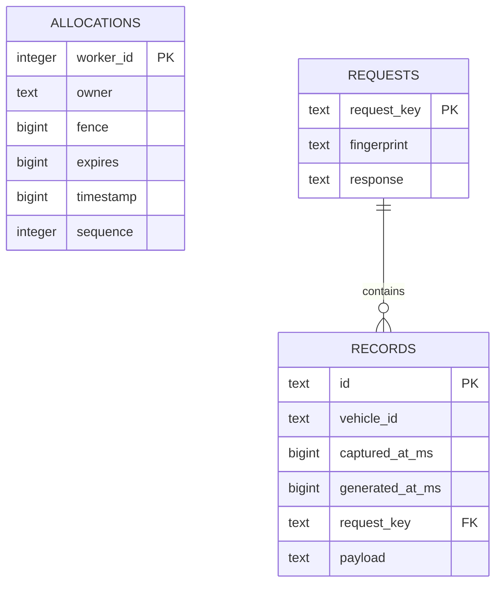
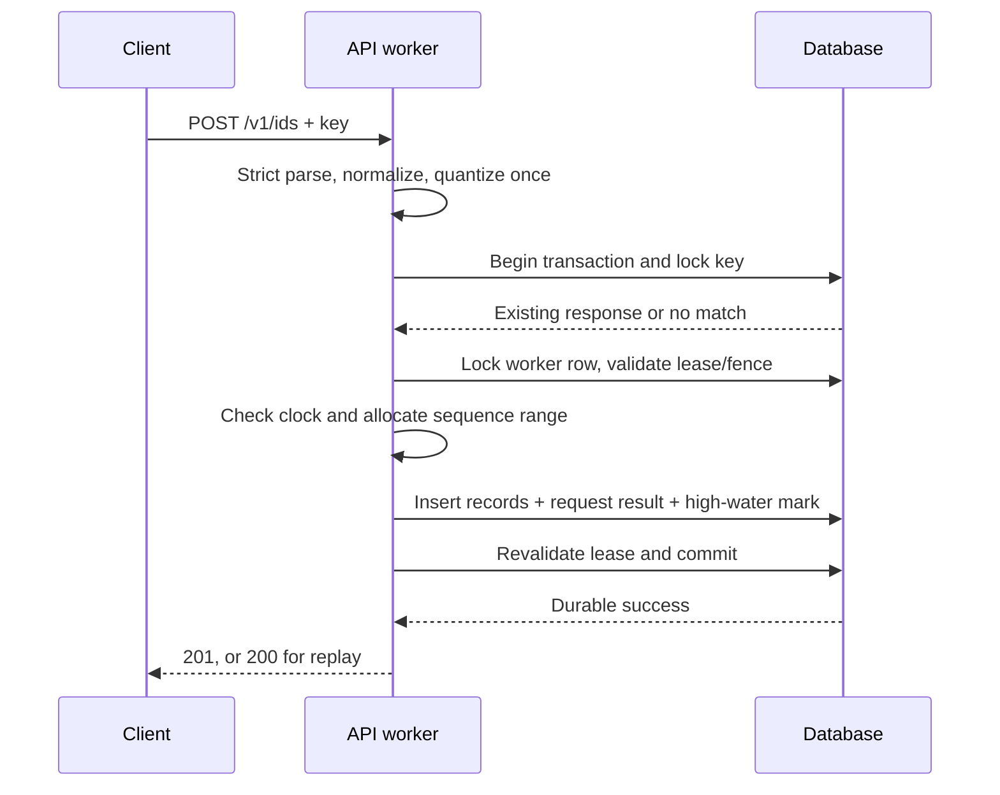

# Data model and lifecycle

The durable service stores allocation safety state, idempotency results, and
immutable event records in the same database. Test Lab reports deliberately use
a different SQLite volume so they remain available during PostgreSQL failures.

## Application schema

The current schema version is 1.

### `schema_version`

| Column | Meaning |
|---|---|
| `version` | Applied application schema version |

The service refuses to run against a schema newer than it understands. Compose
runs the migration job before API containers start.

### `allocations`

| Column | Meaning |
|---|---|
| `worker_id` | Encoded 10-bit worker and primary key |
| `owner` | Random process ownership identity |
| `fence` | Increasing token issued on every acquisition |
| `expires` | Lease expiry in database Unix milliseconds |
| `timestamp` | Last encoded millisecond since custom epoch |
| `sequence` | Last sequence allocated in that millisecond |

The row is both a lease and a durable high-water mark. A transaction locks it,
checks owner/fence/expiry, and advances timestamp/sequence only with its records.
A replacement owner receives a higher fence, making old owners unable to commit.

### `requests`

| Column | Meaning |
|---|---|
| `request_key` | Client or server-generated idempotency key |
| `fingerprint` | SHA-256 of canonical normalized input |
| `response` | Original successful response as canonical JSON |

The stored response is the retry result. A matching key/fingerprint returns it;
a matching key with another fingerprint is a conflict. The response is written
in the same transaction as records and allocation state.

When `captured_at_ms` is omitted, the normalized fingerprint retains `null` while
the server assigns the actual capture time once for record creation. This means
an exact retry has the same logical fingerprint and returns the original data.

### `records`

| Column | Meaning |
|---|---|
| `id` | Canonical 32-character spatial ID |
| `vehicle_id` | Optional caller-supplied history partition |
| `captured_at_ms` | Event/capture time supplied or assigned at receipt |
| `generated_at_ms` | Server time encoded into the ID |
| `request_key` | Request that created the record |
| `payload` | Original normalized fields plus generation metadata |

Records are immutable. Late capture samples are inserted rather than overwriting
newer events. History is ordered by `(captured_at_ms, id)`, which provides a
stable tie-breaker. The `vehicle_history` index supports this access path.

## Generation lifecycle

If the connection disappears after commit but before the response reaches the
client, the client cannot infer the outcome. It resends the same payload and key;
the request row resolves the uncertainty without allocating again.

## Capture time versus generation time

`captured_at_ms` describes when the external event occurred. It can arrive late
and determines vehicle-history order. `generated_at_ms` describes when this
service allocated the ID and is encoded into the identifier.

They are deliberately independent. Rewriting an ID to reflect capture time would
make client-supplied time part of the uniqueness state and allow late events or
bad clocks to interfere with safe allocation.

## Retention

V1 retains records and request results indefinitely. This makes replay behavior
simple and preserves complete history, but storage grows without bound. A real
deployment needs explicit retention, archival, privacy deletion, and capacity
policies that preserve whichever idempotency window clients rely on.

Deleting a request while retaining its records removes retry resolution.
Deleting records while retaining a request can replay IDs whose detailed record
is no longer available. Any future retention design must state these semantics
and perform changes transactionally.

## Legacy migration

The SQLite migrator recognizes older worker state. It refuses migration while a
legacy lease is active. A legacy worker's last timestamp is imported with
sequence 1023, treating that entire millisecond as consumed. It does not invent
event records that were never stored.

## Test Lab schema

The report database contains `runs` and a singleton `fault` record. Each run
stores configuration, status, timeline, and final metrics as JSON. The fault row
stores an absolute expiry before a toxic is activated. The independent watchdog
uses that expiry to restore connectivity even if the runner is paused or dies.
