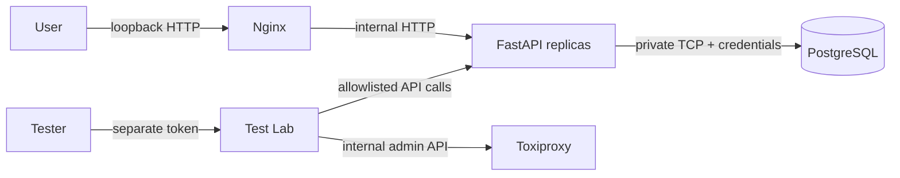

# Security model

This document describes the current trust boundaries and the additional controls
required before exposing the system outside a developer machine.

## Protected assets

- Original precise coordinates, altitude, speed, vehicle identifiers and times.
- Coarse location and generation time embedded in every ID.
- Idempotency keys and stored responses.
- Worker allocation state that protects uniqueness.
- Database credentials and API/Test Lab bearer tokens.
- Test Lab controls capable of interrupting database connectivity.

Spatial IDs are not opaque. Anyone with an ID can decode approximate time,
location, class, worker, and sequence. Use a separate random public identifier or
an access-controlled lookup layer when this disclosure is unacceptable.

## Trust boundaries



Default Compose publishes only the gateway on `127.0.0.1`. PostgreSQL,
Toxiproxy administration, API containers, Prometheus, and the runner are not
host-published. No container mounts the Docker socket.

## Implemented controls

- Optional API bearer token compared with constant-time comparison.
- Mandatory separate Test Lab token in the testing overlay.
- Strict JSON parsing rejects duplicate fields and non-finite constants.
- 64 KiB request-body cap and bounded upload/request time.
- Maximum 64 in-flight API requests per process.
- Batch size capped at 1,000.
- Test Lab caps one active run, 60 seconds, 32 concurrent requests, 100,000
  requested IDs, and ten seconds of network fault.
- Test targets and scenario names are allowlisted; no arbitrary URL or shell input.
- Database pools, lock waits and statement durations are bounded.
- Generic unexpected errors do not return private exception detail.
- Worker fencing prevents an old owner from committing after replacement.
- The browser holds tokens only in component memory, not local storage.
- Test report storage is independent of PostgreSQL outage testing.

## Authentication behavior

When `API_TOKEN` is nonempty, data APIs and `/stats` require:

```http
Authorization: Bearer <API_TOKEN>
```

Liveness, readiness, health alias, and Prometheus metrics remain unauthenticated
so container orchestration can use them. Do not publish those endpoints publicly
without network policy or gateway rules.

Every `/test-api/*` route requires the separate `TEST_TOKEN`. This is intentional:
an identity allowed to read vehicle history should not automatically gain the
ability to disrupt test database connectivity.

## Input and abuse considerations

Vehicle IDs allow only 1–128 ASCII letters, digits, dots, underscores, colons,
or hyphens. Idempotency keys allow 1–128 ASCII characters. Query cursors are
opaque URL-safe base64 encodings and are validated before use. SQL values use
driver parameters; identifiers are not constructed from request data.

The service has process-wide concurrency bounds, not identity-aware rate limits.
A valid caller can still consume all available capacity. Deploy a real gateway
with per-principal quotas before multi-user exposure.

## Secrets

`.env.example` contains development placeholders. `.env` is ignored by Git.
Compose environment variables are not an appropriate long-term production
secret store because they can appear in runtime inspection and diagnostics.

Production should use an orchestrator secret manager, short-lived database
credentials where possible, token rotation, least-privilege database roles, and
separate credentials per environment. Never place tokens in URLs, source files,
screenshots, benchmark output, or committed Test Lab reports.

## Transport security

Local Compose uses HTTP because it binds to loopback. For any remote traffic:

- terminate TLS at a trusted ingress;
- redirect or reject cleartext HTTP;
- validate proxy forwarding headers only from trusted hops;
- protect internal service networks;
- use TLS to PostgreSQL when the network is not host-private;
- define certificate rotation and failure behavior.

## Database permissions

The development database user can migrate and operate the schema. A production
design should separate migration and runtime roles. Runtime needs access to the
application tables but should not create arbitrary schemas, roles, extensions,
or databases. Backup and restore credentials should be separate and audited.

Allocation rows are safety state. Manual edits, truncation, or restoration from
an old backup can invalidate uniqueness. Limit write access and alert on changes
outside the application/migration identities.

## Privacy and retention

The database retains precise event records and idempotency results indefinitely.
That is convenient for the demo but not a privacy policy. A production owner
must define purpose, consent/legal basis, access control, retention, deletion,
export, audit, residency, and incident-notification requirements.

Deleting spatial IDs cannot hide the metadata already encoded in copies of those
IDs. If deletion or confidentiality is a hard requirement, expose opaque IDs
externally and keep spatial identifiers inside a protected system boundary.

## Production gaps

The following are explicitly not implemented:

- TLS termination and automated certificate management.
- User accounts, OAuth/OIDC, roles, tenant isolation, or per-record authorization.
- Per-principal rate limiting and distributed abuse controls.
- Managed secret storage and rotation.
- Audit logs and security-event export.
- Automated dependency/container scanning in the repository.
- PostgreSQL replication, automatic failover, encryption policy, or key management.
- Formal penetration testing, threat-model review, or compliance certification.

Do not describe this repository as production-secure until the deployment adds
and verifies those controls.

## Reporting a vulnerability

Do not include secrets, live coordinates, or exploit details in a public issue.
Repository owners should define a private security contact before publication.
Until then, keep the repository private while coordinating sensitive findings.
